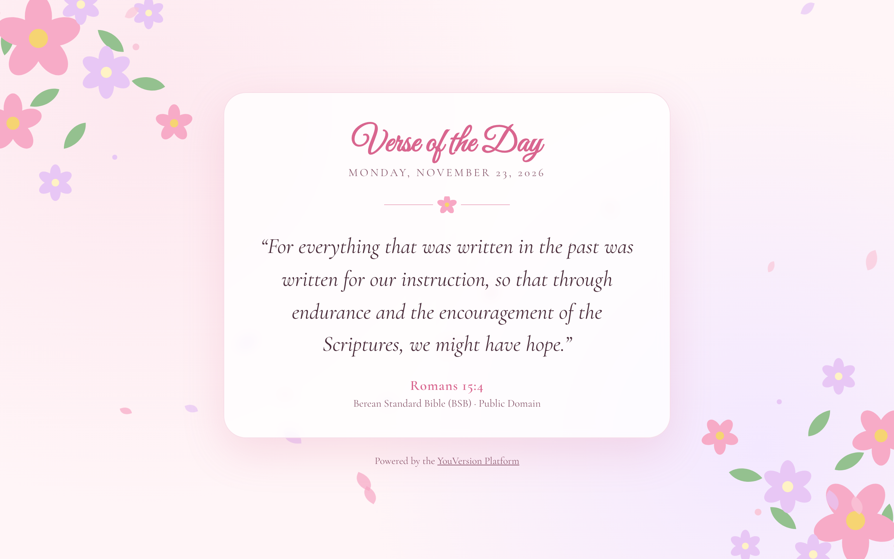

# Verse of the Day

A simple, flowery static site that shows the YouVersion Verse of the Day (Berean Standard Bible) using the [YouVersion Platform API](https://developers.youversion.com/overview).

## How it works

`index.html` runs entirely in the browser:

1. `GET /v1/verse-of-the-days/{day-of-year}` → today's `passage_id`
2. `GET /v1/bibles/3034/passages/{passage_id}?format=text` → BSB verse text
3. `GET /v1/bibles/3034` → version title and copyright for attribution

## Deploy with GitHub Pages

Settings → Pages → Source: **Deploy from a branch** → pick the branch and `/ (root)`.

## Local preview

Open `index.html` in a browser.
